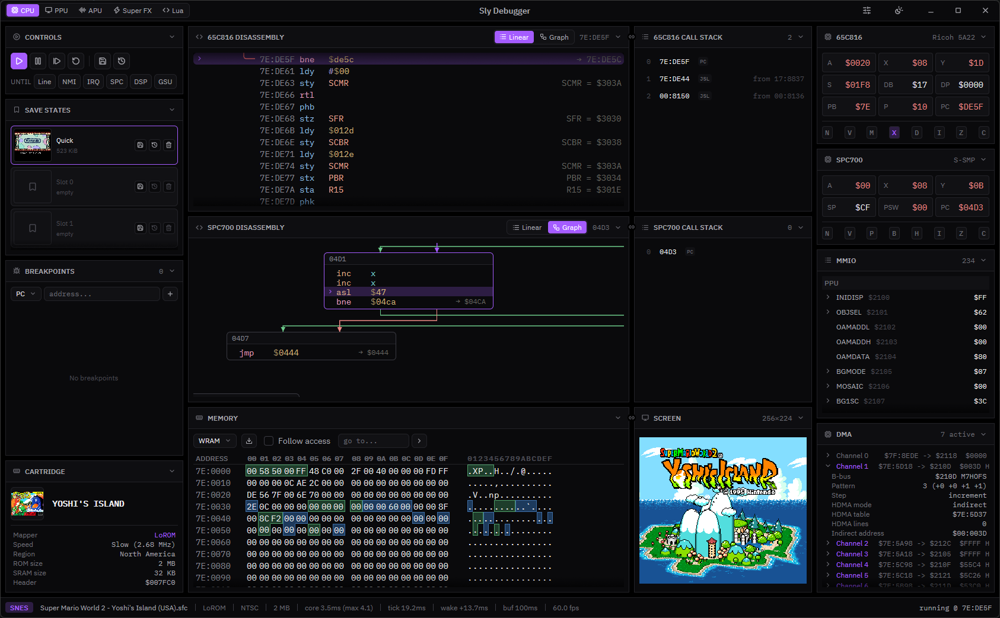
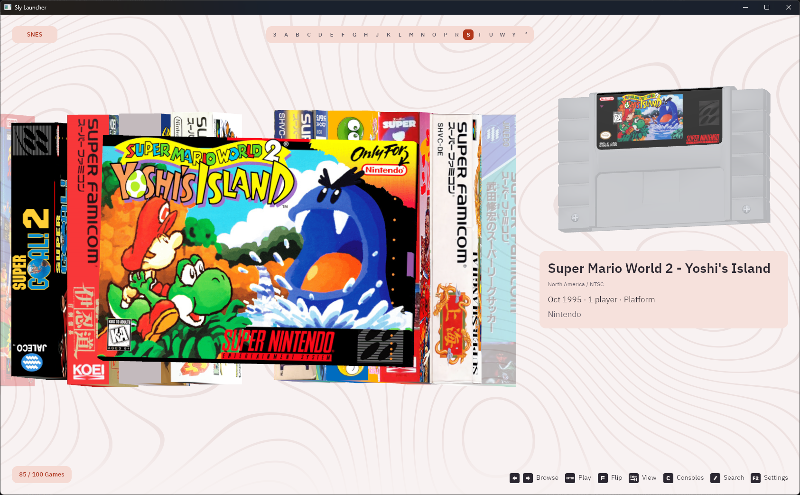
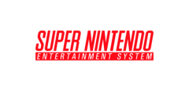
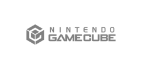
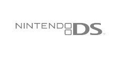
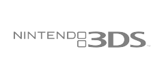

# Sly

Sly is a cross-platform, multi-system emulator for players, homebrew developers and emulator developers alike. It combines a beautiful debugger with a unique take on the classic emulation experience!

[Official website](https://sly.layle.dev/) · [Try the debugger in your browser](https://sly.layle.dev/app)

<p>
  
  
</p>

Sly has three main desktop frontends, alongside its mobile apps:

* **Sly Launcher**: A 3D game library built around box art and cartridges.
* **Sly Classic**: A minimal Qt interface for browsing and playing games.
* **Sly Debugger**: A beautiful debugger packed with features.

Supported platforms:

* Windows, macOS and Linux
* Web browsers via WebGPU (debugger only so far)
* iOS, with Android planned

## Compatibility

Color means playable or work-in-progress. Click on a logo to see the respective compatibility database.

<table>
  <tr>
    <td><a href="https://emu.layle.dev/sly-snes"></a></td>
    <td></td>
    <td></td>
    <td></td>
  </tr>
  <tr>
    <td></td>
    <td></td>
    <td></td>
    <td></td>
  </tr>
  <tr>
    <td></td>
    <td></td>
    <td></td>
    <td></td>
  </tr>
</table>

## Features

**Sly Launcher**
* 3D boxes and cartridges
* Three shelf layouts
* Flippable box art
* Automatic artwork downloads
* Regional packaging and models
* Library search
* Gamepad navigation
* Remappable controls
* Save states

**Debugger**
* Instruction stepping
* Linear and graph disassembly
* CPU registers and call stacks
* CPU and memory breakpoints
* Memory inspection
* MMIO register inspection
* Tile and background viewers
* Sprite and palette viewers
* Audio visualization
* Built-in Lua editor and scripting
* Save states

## Usage

Supported file types:
* SNES: `.sfc`, `.smc`
* GBA: `.gba`

In **Sly Launcher** add your ROM folders in settings (or pass a folder on the command line). **Sly Classic** scans `roms/` in its working directory.

On **iOS**, add games to Sly's `roms/{system}/` folders through the Files app.

Open a game directly in the debugger:

```sh
debugger.exe path/to/game.sfc
```

On macOS and Linux, use `./debugger` instead of `debugger.exe`. The [web debugger](https://sly.layle.dev/app) lets you load a local ROM in a WebGPU-capable browser.

## Default Controls

In the launcher, use arrows to browse, **Enter** to play, **/** to search, **F** to flip a box, **Tab** to change views, and **F2** for settings. During a game, **P** pauses and **Esc** returns to the library. Gamepads are supported; game bindings can be changed in settings.

The launcher's default game bindings are:

| In-game control   | Keyboard          |
| ----------------- | ----------------- |
| D-pad             | Arrow keys        |
| B / A             | Z / X             |
| Y / X (SNES)      | A / S             |
| L / R             | Q / W             |
| Start / Select    | Enter / Backspace |
| Save / load state | F5 / F8           |

## Development Setup

See the [build workflow](.github/workflows/binaries.yml) for platform dependencies, including Linux audio and windowing libraries.

From the repository root:

```sh
git submodule update --init --recursive
cargo run --locked -p modern-launcher -- roms/
cargo run --locked -p debugger -- path/to/game.sfc
```

**Sly Classic** also needs:

* Qt 6 (CI uses 6.11.1), including Multimedia, ShaderTools and private GUI headers
* CMake 4.3 or newer
* Ninja
* A C++23 compiler
* SDL3 3.2 or newer for gamepads

## License

[GPL-3.0](LICENSE) · [Third-party notices](licenses)

Sly is not affiliated with Nintendo or other console manufacturers. Game titles, artwork and trademarks belong to their respective owners.
